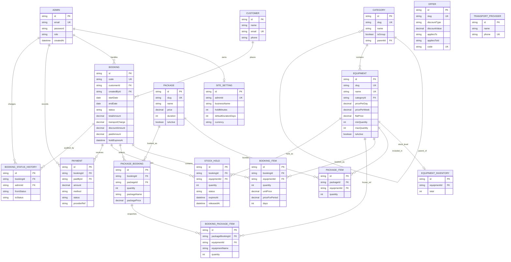

# PartyPlay — Database Specification

**Database:** PostgreSQL 17 (`partyplay`)
**ORM:** Prisma 6 (`server/prisma/schema.prisma`)
**Status:** reflects the schema *as implemented* on branch `feat/phase-2.2-database-design`, not the earlier conceptual draft.

This document is the reference for the PartyPlay data model: entities, field
constraints, relationships, and the inventory / pricing / payment rules the API
must enforce. Anything marked **app-enforced** is not protected by a database
constraint and must be validated in the service layer.

---

## 1. Scope

PartyPlay is an equipment-rental business (bouncing castles, chairs, tents,
packages). There are **no customer accounts** — only staff log in. Customers
exist as contact records attached to bookings.

Out of scope for this document: API shapes, authentication flows, UI.

---

## 2. Entity overview

| # | Model | Responsibility |
|---|-------|----------------|
| 1 | `Admin` | Staff credentials and role |
| 2 | `SiteSetting` | Business profile, contact/social links, hold window |
| 3 | `Category` | Self-referencing catalogue tree (groups + leaf categories) |
| 4 | `Equipment` | Rentable item, pricing, limits |
| 5 | `EquipmentInventory` | Units owned per equipment (the stock ceiling) |
| 6 | `Package` | Bundle sold at a package price |
| 7 | `PackageItem` | Equipment + quantity included in a package |
| 8 | `Customer` | Name / phone / optional email |
| 9 | `Booking` | Rental request: dates, status, agreed totals, delivery |
| 10 | `BookingItem` | Equipment line on a booking (price frozen) |
| 11 | `PackageBooking` | Package line on a booking (name + price frozen) |
| 12 | `BookingPackageItem` | Equipment contents of a booked package (frozen) |
| 13 | `StockHold` | Temporary reservation owned by a pending booking |
| 14 | `BookingStatusHistory` | Audit trail of status transitions |
| 15 | `Payment` | Manual payment records against a booking |
| 16 | `Offer` | Promotions (loose reference to equipment/package) |
| 17 | `TransportProvider` | Delivery/transport contacts |

Enums: `Role`, `DiscountType`, `OfferAppliesTo`, `BookingStatus`,
`StockHoldStatus`, `PaymentMethod`, `PaymentStatus`.

---

## 3. ERD



`Offer` and `TransportProvider` have no foreign keys. `Offer.appliesToId` is a
**loose reference** (an equipment or package id depending on `appliesTo`) and is
*not* protected by a foreign key — deleted equipment leaves dangling offers
(app-enforced cleanup).

---

## 4. Field constraints

Type mapping: Prisma `String` → `text`, `Decimal @db.Decimal(10,2)` →
`numeric(10,2)`, `DateTime` → `timestamp(3)`, `DateTime @db.Date` → `date`,
`@db.VarChar(n)` → `varchar(n)`.

Foreign-key actions follow Prisma defaults unless stated: **required relation →
`ON DELETE RESTRICT`**, **optional relation → `ON DELETE SET NULL`**, updates
cascade. Explicit actions are noted.

**CHECK constraints** cannot be expressed in Prisma's schema language, so they
live in a hand-written migration
(`20261113194645_harden_booking_index_and_check_constraints`). Prisma does not
see them and will never drop them; add new ones the same way, not in
`schema.prisma`. Rows listed as **DB-enforced** are rejected by PostgreSQL;
**app-enforced** rules exist only in the service layer.

### 4.1 Admin

| Field | Type | Null | Default | Notes |
|---|---|---|---|---|
| `id` | text | no | `cuid()` | PK |
| `email` | text | no | — | **UNIQUE**, login identifier |
| `name` | text | yes | — | |
| `password` | text | no | — | bcrypt hash, cost 12 (app-enforced) |
| `role` | `Role` | no | `STAFF` | |
| `createdAt` | timestamp(3) | no | `now()` | |
| `updatedAt` | timestamp(3) | no | auto | |

### 4.2 Category

| Field | Type | Null | Default | Notes |
|---|---|---|---|---|
| `id` | text | no | `cuid()` | PK |
| `slug` | text | no | — | **UNIQUE**, kebab-case (app-enforced regex) |
| `name` | text | no | — | |
| `description` | text | yes | — | |
| `isGroup` | boolean | no | `false` | group node that holds sub-categories |
| `parentId` | text | yes | — | FK → `Category.id`, `SET NULL` on delete |
| `createdAt` / `updatedAt` | timestamp(3) | no | `now()` / auto | |

Indexes: `(parentId)`, unique `(slug)`.

**App-enforced:** deletion is rejected while `Equipment` rows reference the
category (see `routes/categories.ts`).

### 4.3 Equipment

| Field | Type | Null | Default | Notes |
|---|---|---|---|---|
| `id` | text | no | `cuid()` | PK |
| `slug` | text | no | — | **UNIQUE** |
| `name` | text | no | — | **UNIQUE** |
| `categoryId` | text | no | — | FK → `Category.id`, `RESTRICT` |
| `description` | text | yes | — | |
| `imageUrl` | varchar(2048) | yes | — | Cloudinary URL |
| `imagePublicId` | varchar(128) | yes | — | needed to delete the asset later |
| `note` | text | yes | — | e.g. "requires a flat, dry surface" |
| `pricePerDay` | numeric(10,2) | yes | — | daily rate |
| `pricePerWeek` | numeric(10,2) | yes | — | weekly rate |
| `flatPrice` | numeric(10,2) | yes | — | flat per-unit price, ignores duration |
| `minQuantity` | int | no | `1` | per booking line |
| `maxQuantity` | int | no | `10` | per booking line |
| `isActive` | boolean | no | `true` | public visibility |
| `createdAt` / `updatedAt` | timestamp(3) | no | `now()` / auto | |

Indexes: `(categoryId)`, unique `(slug)`.

**DB-enforced:** `minQuantity >= 1` and `maxQuantity >= minQuantity`.
**App-enforced:** at least one of the three price fields must be set.

### 4.4 EquipmentInventory

| Field | Type | Null | Default | Notes |
|---|---|---|---|---|
| `id` | text | no | `cuid()` | PK |
| `equipmentId` | text | no | — | FK → `Equipment.id`, **CASCADE** |
| `total` | int | no | `0` | units actually owned — the stock ceiling |
| `createdAt` / `updatedAt` | timestamp(3) | no | `now()` / auto | |

Unique `(equipmentId)` — one row per equipment. This is the *only* place stock
totals live; reserved counts are always derived, never stored.

**DB-enforced:** `total >= 0`.

### 4.5 Package

| Field | Type | Null | Default | Notes |
|---|---|---|---|---|
| `id` | text | no | `cuid()` | PK |
| `slug` | text | no | — | **UNIQUE** |
| `name` | text | no | — | not unique (unlike equipment `name`) |
| `description` | text | yes | — | |
| `imageUrl` | varchar(2048) | yes | — | |
| `imagePublicId` | varchar(128) | yes | — | |
| `price` | numeric(10,2) | **no** | — | current package price |
| `minQuantity` | int | no | `1` | minimum guests |
| `maxQuantity` | int | yes | — | optional guest cap |
| `duration` | int | yes | — | recommended rental days |
| `isFeatured` | boolean | no | `false` | homepage highlight |
| `isActive` | boolean | no | `true` | |
| `createdAt` / `updatedAt` | timestamp(3) | no | `now()` / auto | |

Indexes: unique `(slug)`.

**DB-enforced:** `minQuantity >= 1`; `maxQuantity` is null or
`>= minQuantity`; `duration` is null or `>= 1`.

### 4.6 PackageItem

| Field | Type | Null | Default | Notes |
|---|---|---|---|---|
| `id` | text | no | `cuid()` | PK |
| `packageId` | text | no | — | FK → `Package.id`, **CASCADE** |
| `equipmentId` | text | no | — | FK → `Equipment.id`, `RESTRICT` |
| `quantity` | int | no | `1` | units per package |

Unique `(packageId, equipmentId)` — one line per equipment per package; repeats
are expressed by increasing `quantity`. Indexes: `(packageId)`, `(equipmentId)`.

**DB-enforced:** `quantity >= 1`.

### 4.7 Customer

| Field | Type | Null | Default | Notes |
|---|---|---|---|---|
| `id` | text | no | `cuid()` | PK |
| `name` | text | no | — | |
| `email` | text | yes | — | **UNIQUE**; Postgres allows many `NULL`s |
| `phone` | text | yes | — | not unique — households may share a phone |
| `createdAt` / `updatedAt` | timestamp(3) | no | `now()` / auto | |

Indexes: unique `(email)`, `(email)`.

### 4.8 Booking

| Field | Type | Null | Default | Notes |
|---|---|---|---|---|
| `id` | text | no | `cuid()` | PK |
| `code` | text | no | `cuid()` | **UNIQUE** — public reference (`PP-XXXXXX` generated app-side; the default is only a fallback) |
| `customerId` | text | no | — | FK → `Customer.id`, `RESTRICT` |
| `startDate` | date | no | — | inclusive rental start |
| `endDate` | date | no | — | inclusive rental end |
| `status` | `BookingStatus` | no | `PENDING` | see §6 |
| `notes` | text | yes | — | internal |
| `specialRequests` | text | yes | — | customer-supplied |
| `totalAmount` | numeric(10,2) | **no** | — | agreed total at submission |
| `transportCharge` | numeric(10,2) | no | `0` | owner-confirmed delivery fee |
| `discountAmount` | numeric(10,2) | no | `0` | |
| `paidAmount` | numeric(10,2) | no | `0` | **derived cache**, see §7.3 |
| `currency` | text | no | `"KES"` | |
| `createdById` | text | yes | — | FK → `Admin.id`, `SET NULL`; null = submitted by customer/staff intake |
| `createdAt` / `updatedAt` | timestamp(3) | no | `now()` / auto | |
| `approvedAt` | timestamp(3) | yes | — | |
| `cancelledAt` | timestamp(3) | yes | — | |
| `fulfilmentDate` | timestamp(3) | yes | — | actual delivery/event date |
| `deliveredBy` | text | yes | — | driver/boda name |
| `dropoffAddress` / `dropoffNotes` | text | yes | — | |
| `pickupAddress` / `pickupNotes` | text | yes | — | |
| `holdExpiresAt` | timestamp(3) | yes | — | summary of the pending hold window; authoritative per-item expiry lives on `StockHold.expiresAt` |

Indexes: `(customerId)`, `(status)`, `(createdById)`, unique `(code)`, and
`(status, startDate, endDate)` for availability/overlap queries.

**DB-enforced:** `endDate >= startDate` (equal dates are a valid one-day rental).
**App-enforced:** `totalAmount >= 0`; `paidAmount <= totalAmount`.

### 4.9 BookingItem

| Field | Type | Null | Default | Notes |
|---|---|---|---|---|
| `id` | text | no | `cuid()` | PK |
| `bookingId` | text | no | — | FK → `Booking.id`, **CASCADE** |
| `equipmentId` | text | no | — | FK → `Equipment.id`, `RESTRICT` |
| `quantity` | int | no | — | units requested |
| `unitPrice` | numeric(10,2) | no | — | **snapshot** of the price used |
| `priceForPeriod` | numeric(10,2) | no | — | computed line total for the rental period |
| `days` | int | no | — | billable days for this line |

Indexes: `(bookingId)`, `(equipmentId)`.

**DB-enforced:** `quantity >= 1` and `days >= 1`. No unique
`(bookingId, equipmentId)` — duplicate lines are structurally allowed (see §8).

### 4.10 PackageBooking

| Field | Type | Null | Default | Notes |
|---|---|---|---|---|
| `id` | text | no | `cuid()` | PK |
| `packageId` | text | no | — | FK → `Package.id`, `RESTRICT` |
| `bookingId` | text | no | — | FK → `Booking.id`, **CASCADE** |
| `quantity` | int | no | `1` | how many of this package |
| `packageName` | text | no | — | **snapshot** |
| `packagePrice` | numeric(10,2) | no | — | **snapshot** per package |
| `createdAt` | timestamp(3) | no | `now()` | |

Unique `(packageId, bookingId)` — a booking can reference a package only once;
multiples go through `quantity`. Indexes: `(bookingId)`.

**DB-enforced:** `quantity >= 1`.

### 4.11 BookingPackageItem

| Field | Type | Null | Default | Notes |
|---|---|---|---|---|
| `id` | text | no | `cuid()` | PK |
| `packageBookingId` | text | no | — | FK → `PackageBooking.id`, **CASCADE** |
| `equipmentId` | text | yes | — | FK → `Equipment.id`, **SET NULL** — snapshot survives deletion |
| `equipmentName` | text | no | — | **snapshot** |
| `quantity` | int | no | — | **total units**, package `quantity` already multiplied in |

Indexes: `(packageBookingId)`, `(equipmentId)`.

This table exists so a booked package's contents are **rows, not JSON**. That
makes `SUM(quantity)` aggregation possible for availability, which a `TEXT`
column (the previous `PackageBooking.itemsSnapshot`) could not do.

**DB-enforced:** `quantity >= 1`.

### 4.12 StockHold

| Field | Type | Null | Default | Notes |
|---|---|---|---|---|
| `id` | text | no | `cuid()` | PK |
| `bookingId` | text | no | — | FK → `Booking.id`, **CASCADE** |
| `equipmentId` | text | no | — | FK → `Equipment.id`, **CASCADE** |
| `quantity` | int | no | — | units held |
| `status` | `StockHoldStatus` | no | `ACTIVE` | |
| `expiresAt` | timestamp(3) | **no** | — | window end |
| `releasedAt` | timestamp(3) | yes | — | set when released/consumed/expired |
| `createdAt` / `updatedAt` | timestamp(3) | no | `now()` / auto | |

Unique `(bookingId, equipmentId)` — one hold per equipment per booking.
Indexes: `(equipmentId, status)` (availability path), `(expiresAt)` (sweeper
scan), `(bookingId)`.

**DB-enforced:** `quantity >= 1`. **App-enforced:** `expiresAt > createdAt`.

### 4.13 BookingStatusHistory

| Field | Type | Null | Default | Notes |
|---|---|---|---|---|
| `id` | text | no | `cuid()` | PK |
| `bookingId` | text | no | — | FK → `Booking.id`, **CASCADE** |
| `fromStatus` | `BookingStatus` | yes | — | null on the first record |
| `toStatus` | `BookingStatus` | no | — | |
| `reason` | text | yes | — | |
| `note` | text | yes | — | |
| `adminId` | text | yes | — | FK → `Admin.id`, `SET NULL` |
| `createdAt` | timestamp(3) | no | `now()` | |

Indexes: `(bookingId)`, `(adminId)`.

### 4.14 Payment

| Field | Type | Null | Default | Notes |
|---|---|---|---|---|
| `id` | text | no | `cuid()` | PK |
| `bookingId` | text | no | — | FK → `Booking.id`, `RESTRICT` |
| `paidById` | text | yes | — | FK → `Admin.id`, `SET NULL` |
| `amount` | numeric(10,2) | no | — | |
| `method` | `PaymentMethod` | no | — | |
| `status` | `PaymentStatus` | no | `PENDING` | |
| `providerRef` | text | yes | — | e.g. M-Pesa receipt, not unique |
| `description` | text | yes | — | |
| `paidAt` | timestamp(3) | yes | — | null until confirmed |
| `createdAt` / `updatedAt` | timestamp(3) | no | `now()` / auto | |

Indexes: `(bookingId)`, `(status)`.

**App-enforced:** `amount > 0`.

### 4.15 Offer

Loose promotion container; no foreign keys.

| Field | Type | Null | Default | Notes |
|---|---|---|---|---|
| `id` | text | no | `cuid()` | PK |
| `slug` | text | no | — | **UNIQUE** |
| `name` | text | no | — | |
| `description` | text | yes | — | |
| `discountType` | `DiscountType` | no | — | |
| `discountValue` | numeric(10,2) | no | — | percent or amount; validation depends on type |
| `appliesTo` | `OfferAppliesTo` | no | — | |
| `appliesToId` | text | yes | — | equipment/package id, **not** a FK |
| `code` | text | yes | — | **UNIQUE**; null = automatic offer |
| `startsAt` / `endsAt` | timestamp(3) | yes | — | null = open-ended |
| `isActive` | boolean | no | `true` | |
| `createdAt` / `updatedAt` | timestamp(3) | no | `now()` / auto | |

Indexes: `(appliesTo, appliesToId)`, unique `(code)`.

**App-enforced:** `PERCENTAGE` requires `discountValue BETWEEN 0 AND 100`;
`FIXED_AMOUNT` requires `discountValue > 0`; `ONE_EQUIPMENT` / `ONE_PACKAGE`
require `appliesToId`; other scopes must leave it null.

### 4.16 TransportProvider

| Field | Type | Null | Default | Notes |
|---|---|---|---|---|
| `id` | text | no | `cuid()` | PK |
| `name` | text | no | — | |
| `phone` | text | no | — | **UNIQUE** |
| `serviceArea` | text | yes | — | |
| `notes` | text | yes | — | |
| `isActive` | boolean | no | `true` | |
| `createdAt` / `updatedAt` | timestamp(3) | no | `now()` / auto | |

### 4.17 SiteSetting

| Field | Type | Null | Default | Notes |
|---|---|---|---|---|
| `id` | text | no | `cuid()` | PK |
| `adminId` | text | no | — | FK → `Admin.id`, **CASCADE**, **UNIQUE** — one profile per admin |
| `businessName` | text | no | `"PartyPlay"` | |
| `contactPhone` | text | yes | — | |
| `contactWhatsApp` | text | yes | — | |
| `contactEmail` | text | yes | — | |
| `address` | text | yes | — | |
| `aboutText` | text | yes | — | |
| `facebookUrl` / `instagramUrl` / `tiktokUrl` / `xUrl` | text | yes | — | |
| `defaultDurationDays` | int | no | `1` | used when a booking omits duration |
| `holdMinutes` | int | no | `120` | pending-request hold window |
| `currency` | text | no | `"KES"` | |
| `updatedAt` | timestamp(3) | no | auto | |

---

## 5. Enums

| Enum | Values |
|---|---|
| `Role` | `OWNER`, `ADMIN`, `STAFF` |
| `DiscountType` | `PERCENTAGE`, `FIXED_AMOUNT` |
| `OfferAppliesTo` | `ALL_BOOKINGS`, `ALL_EQUIPMENT`, `ALL_PACKAGES`, `ONE_EQUIPMENT`, `ONE_PACKAGE` |
| `BookingStatus` | `PENDING`, `APPROVED`, `REJECTED`, `CANCELLED`, `COMPLETED`, `NO_SHOW` |
| `StockHoldStatus` | `ACTIVE`, `CONSUMED`, `RELEASED`, `EXPIRED` |
| `PaymentMethod` | `MANUAL`, `MPESA`, `BANK_TRANSFER`, `CASH`, `OTHER` |
| `PaymentStatus` | `PENDING`, `PAID`, `FAILED`, `REFUNDED` |

---

## 6. Booking lifecycle

```
PENDING ──approve──▶ APPROVED ──fulfil───▶ COMPLETED
   │                    │
   │                    └──no-show─────▶ NO_SHOW
   │                    └──cancel──────▶ CANCELLED
   ├──reject──────────────────────────▶ REJECTED
   └──cancel──────────────────────────▶ CANCELLED
```

Every transition writes a `BookingStatusHistory` row (`fromStatus` → `toStatus`,
optional `adminId`).

### 6.1 Hold lifecycle

| Trigger | `StockHold.status` | Effect on availability |
|---|---|---|
| Booking submitted (`PENDING`) | `ACTIVE` rows created, `expiresAt = now + holdMinutes` | units subtracted |
| Approved (`APPROVED`) | all rows → `CONSUMED`, `releasedAt = now` | units still subtracted, now via item rows |
| Rejected / cancelled before approval | rows → `RELEASED`, `releasedAt = now` | units returned |
| Window lapses (`expiresAt` passed) | rows → `EXPIRED` (lazy sweep) | units returned once `expiresAt` is in the past |

`ACTIVE` holds are the only status that reserves stock; expired rows are ignored
by time comparison even if not yet swept.

---

## 7. Business rules

### 7.1 Rule A — inventory must account for packages

Availability of an equipment item over a date range is:

```
available = total - reserved

reserved = Σ BookingItem.quantity          (APPROVED, overlapping)
         + Σ BookingPackageItem.quantity   (APPROVED, overlapping)
         + Σ StockHold.quantity            (ACTIVE, unexpired, PENDING, overlapping)
```

`available` is clamped at 0 for display.

**Overlap is inclusive on both ends.** A booking occupies stock when:

```
booking.startDate <= requested.endDate
AND booking.endDate >= requested.startDate
```

So a booking ending 5 Dec and one starting 5 Dec both consume 5 Dec.

**Worked example (from the design doc):** 10 chairs in stock; a package includes
4 chairs; a customer books 1 package plus 3 extra chairs.

```
BookingPackageItem.quantity = 4   (1 × package quantity 1 × 4 chairs)
BookingItem.quantity        = 3
reserved                    = 7
available                   = 3
```

Requesting more than 3 chairs for those dates must be rejected.

**Status → reservation mapping**

| `BookingStatus` | Counts against stock? | Via |
|---|---|---|
| `PENDING` | yes, until hold expiry | `StockHold` (`ACTIVE`) |
| `APPROVED` | yes | `BookingItem` + `BookingPackageItem` |
| `COMPLETED` | no (rental window has passed) | — |
| `REJECTED` | no | — |
| `CANCELLED` | no | — |
| `NO_SHOW` | no | — |

Only `APPROVED` is queried as confirmed; a `COMPLETED` booking cannot overlap a
future range, so it needs no special case. If a booking can be completed *before*
its `endDate`, it must be moved to `CANCELLED` instead.

**Implementation:** `server/src/services/availability.ts` —
`getReservedQuantities()`, `getAvailability()`, `findShortages()`.

### 7.2 Rule B — historical prices must not change

Catalogue edits must never rewrite an agreed booking. Frozen fields:

| Frozen value | Stored on | Source |
|---|---|---|
| Equipment price used | `BookingItem.unitPrice` | `Equipment.pricePerDay` / `pricePerWeek` / `flatPrice` |
| Line total for the period | `BookingItem.priceForPeriod` | computed at submit |
| Billable days | `BookingItem.days` | `startDate`–`endDate` |
| Package name | `PackageBooking.packageName` | `Package.name` |
| Package price | `PackageBooking.packagePrice` | `Package.price` |
| Package contents | `BookingPackageItem` rows | `PackageItem` rows |
| Included equipment names | `BookingPackageItem.equipmentName` | `Equipment.name` |
| Agreed total | `Booking.totalAmount` | computed at submit |
| Delivery charge | `Booking.transportCharge` | owner-confirmed |
| Discount | `Booking.discountAmount` | offers applied at submit |

Consequences to respect in code:

- Availability must read `BookingPackageItem`, **not** `PackageItem`, for booked
  packages — otherwise a package edit silently changes past consumption.
- Re-pricing a booking is an explicit admin action that rewrites the snapshots;
  it never happens as a side effect of a catalogue update.
- Deleting equipment sets `BookingPackageItem.equipmentId` to null but keeps the
  name and quantity, so history survives.

**Total formula:** `totalAmount = Σ BookingItem.priceForPeriod
+ Σ (PackageBooking.packagePrice × PackageBooking.quantity)
+ transportCharge − discountAmount`.

### 7.3 Rule C — payment status is separate from booking status

A booking can be `APPROVED` and unpaid. Payments are independent rows.

```
outstanding = totalAmount − Σ Payment.amount  (where status = 'PAID')
```

- `Payment.status = PAID` is the only status that reduces the balance;
  `PENDING`, `FAILED` and `REFUNDED` do not.
- `Booking.paidAmount` is a **cache** for listing/UI. `Payment` rows are the
  source of truth; `paidAmount` must be recomputed inside the same transaction
  that writes a payment.
- Approval must not require full payment unless the business decides otherwise —
  it is currently a manual decision, not an enforced rule.

---

## 8. Constraints and hardening

### 8.1 Applied

Migration `20261113194645_harden_booking_index_and_check_constraints` adds:

| Constraint | Table | Rule |
|---|---|---|
| `Booking_status_startDate_endDate_idx` | `Booking` | index for `status` + date-range overlap lookups |
| `Booking_dates_check` | `Booking` | `endDate >= startDate` |
| `BookingItem_quantity_check` | `BookingItem` | `quantity >= 1` |
| `BookingItem_days_check` | `BookingItem` | `days >= 1` |
| `PackageBooking_quantity_check` | `PackageBooking` | `quantity >= 1` |
| `BookingPackageItem_quantity_check` | `BookingPackageItem` | `quantity >= 1` |
| `StockHold_quantity_check` | `StockHold` | `quantity >= 1` |
| `PackageItem_quantity_check` | `PackageItem` | `quantity >= 1` |
| `EquipmentInventory_total_check` | `EquipmentInventory` | `total >= 0` |
| `Equipment_quantity_range_check` | `Equipment` | `minQuantity >= 1 AND maxQuantity >= minQuantity` |
| `Package_minQuantity_check` | `Package` | `minQuantity >= 1` |
| `Package_maxQuantity_check` | `Package` | `maxQuantity IS NULL OR maxQuantity >= minQuantity` |
| `Package_duration_check` | `Package` | `duration IS NULL OR duration >= 1` |

A single-day booking (`startDate = endDate`) is accepted; zero quantities, zero
days, inverted dates and negative stock are rejected with SQLSTATE `23514`.

### 8.2 Remaining gaps

1. **No atomicity for stock checks.** `findShortages()` then insert is a
   read-then-write race: two concurrent requests can both pass. Wrap booking
   creation in `db.$transaction(..., { isolationLevel: 'Serializable' })` (retry
   on `40001`) or take a per-equipment advisory lock. CHECK constraints do not
   help here — they cannot express "sum of overlapping reservations ≤ total".
2. **Hold expiry is lazy.** Nothing sweeps `StockHold`; a `PENDING` booking never
   moves to a terminal state and `Booking.holdExpiresAt` drifts. Add a periodic
   job that marks expired holds `EXPIRED` and cancels abandoned bookings.
3. **`BookingItem` has no unique `(bookingId, equipmentId)`.** Duplicate lines
   are allowed. Sums remain correct, but normalise to one line per equipment and
   add the constraint.
4. **`Offer.appliesToId` is not a FK.** Dangling offers after equipment/package
   deletion must be cleaned up in the service layer.
5. **`Offer.discountValue` bounds are app-enforced.** `PERCENTAGE` must be
   0–100 and `FIXED_AMOUNT` must be positive; this is a conditional rule, so it
   needs either a `CHECK` with `discountType` or service validation.
6. **`Equipment` pricing method is ambiguous.** If `pricePerDay` and `flatPrice`
   are both set, precedence is undefined. Document and enforce one method per
   item (e.g. a `pricingMode` enum).
7. **`Booking.code` default is a `cuid()`.** The intended `PP-XXXXXX` public
   code must be generated before insert; the default only exists to keep the
   column non-null.
8. **`Booking.paidAmount <= totalAmount` is app-enforced** and deliberately not a
   `CHECK`: editing `totalAmount` after taking payment would otherwise make
   legitimate rows unwritable. Recompute `paidAmount` from `Payment` rows.
9. **`Booking_status_idx` is now redundant** — `(status)` is a prefix of
   `(status, startDate, endDate)`. Safe to drop to save a write per booking.
10. **No `updatedAt` on `BookingPackageItem` / `BookingStatusHistory`.** Fine for
    append-only rows, but note they are immutable by intent.

---

## 9. Migration history

| # | Migration | Summary |
|---|---|---|
| 1 | `20261027133155_full_schema` | Initial full schema |
| 2 | `20261027133627_full_schema_revised` | Category tree, equipment pricing rework, `Customer.email` optional, booking delivery/transport fields, `PackageBooking` snapshots, drop `UserSession` |
| 3 | `20261113194014_phase_2_2_stock_holds_and_package_snapshots` | Add `StockHold` + `StockHoldStatus`, add `BookingPackageItem`, add `PackageBooking.quantity`, drop JSON `PackageBooking.itemsSnapshot` |
| 4 | `20261113194645_harden_booking_index_and_check_constraints` | `(status, startDate, endDate)` index; `CHECK` constraints for quantities and date ranges |

Apply with `npm run db:migrate --workspace server` (`prisma migrate dev`).
Check state with `npx prisma migrate status` from `server/`.
